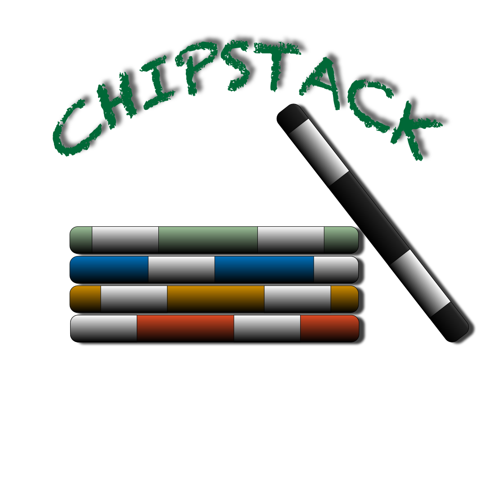

# Chipstack

<div align="center">

</div>

A terminal casino (poker and blackjack) written in C++17 with an [FTXUI](https://github.com/ArthurSonzogni/FTXUI) interface.

## Requirements

- CMake 3.14 or newer
- A C++17 compiler (Clang, GCC or MSVC)
- Internet access on the first configure: CMake downloads FTXUI through `FetchContent`. GoogleTest is taken from the system when installed, otherwise downloaded too

## Building

Always build **out of source**, in a separate `build/` directory:

```sh
cmake -S . -B build
cmake --build build
```

The `chipstack` executable ends up in `build/`:

```sh
./build/chipstack
```

To build without the tests:

```sh
cmake -S . -B build -DBUILD_TESTS=OFF
```

### Running the tests

```sh
cmake --build build
ctest --test-dir build --output-on-failure
```

You can also run the test binary directly with `./build/chipstack_tests`.

### Editor support (clangd)

To get a `compile_commands.json` for clangd or another language server, generate it in `build/` and symlink it into the root:

```sh
cmake -S . -B build -DCMAKE_EXPORT_COMPILE_COMMANDS=ON
ln -sf build/compile_commands.json compile_commands.json
```

Both the symlink and `build/` are git-ignored.

### Don't build in the source tree

Running `cmake .` from the repository root (an *in-source* build) writes `CMakeCache.txt`, `CMakeFiles/`, `Makefile`, `cmake_install.cmake` and other generated files next to the sources. `.gitignore` covers them as a safety net, but they clutter the tree. A leftover `CMakeCache.txt` in the root can also make CMake reuse the root as the build directory, for example when you run `cmake ..` from inside `build/`. If you built in the source tree by mistake, clean up with:

```sh
rm -rf CMakeCache.txt CMakeFiles cmake_install.cmake Makefile CTestTestfile.cmake \
       CPackConfig.cmake CPackSourceConfig.cmake chipstack_tests*.cmake \
       compile_commands.json _deps
```

A clean rebuild is just `rm -rf build` followed by the build steps above.

## Project layout

- `src/core`: game rules with no UI. `cards`, `players` and `table` are shared; `poker` and `blackjack` never include each other. Each game exposes a player interface (`PokerPlayer`, `BlackjackPlayer`) and an observer (`PokerObserver`, `BlackjackObserver`).
- `src/ai`: bots. `BotPlayer` implements both game interfaces and delegates to `PokerStrategy` / `BlackjackStrategy`.
- `src/ui`: FTXUI front end. `screens/game_screen` owns everything both games share (game loop, pause menu, header, log, input routing); `poker_screen` and `blackjack_screen` only add their own rendering and input. New games are registered in `game_catalog.cpp`.

## Code style

Formatting is enforced by `.clang-format` (tabs shown 2 wide, 80 columns) and `.editorconfig`. Format before committing:

```sh
clang-format -i $(git ls-files '*.cpp' '*.hpp')
```

In vim without an EditorConfig plugin: `:set noexpandtab tabstop=2 shiftwidth=2`.
